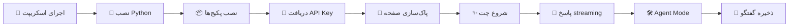

<div align="center">

<a href="https://github.com/AyhanMansur/AyhanX-Agent">
  
</a>

<br/>

[](https://linux.org)
[](https://linux.org)
[](https://www.python.org)
[](https://github.com/AyhanMansur/AyhanX-Agent/blob/main/LICENSE)
[](https://github.com/AyhanMansur/AyhanX-Agent/)
[](https://github.com/AyhanMansur/AyhanX-Agent/)

</div>

---

## 🌟 درباره پروژه

**AyhanX-Agent** یک کلاینت ترمینالی پریمیوم و تک‌فایلی برای چت تعاملی با **DeepSeek** است. طراحی آن از تجربه‌ی کاربری **Claude Code** الهام گرفته و ترکیبی از رابط گرادیانت مدرن، پاسخ‌های streaming زنده، Agent Mode با ابزارهای داخلی، و نصب کاملاً خودکار را در یک اسکریپت Bash ارائه می‌دهد.

هدف این پروژه، حذف کامل پیچیدگی‌های معمول (منوهای شلوغ، پنل‌های وب، پیکربندی دستی) و جایگزینی آن با یک جریان کاری ساده است: **یک دستور اجرا کن، مستقیم وارد چت شو.**

> 🔒 **بدون منو، بدون پنل وب، بدون پیکربندی.** یک دستور بزن، مستقیم وارد چت شو.

این پروژه یک بازنویسی کامل و ارتقاءیافته محسوب می‌شود که قابلیت‌های کلیدی زیر را به اکوسیستم کلاینت‌های ترمینالی DeepSeek اضافه می‌کند:

| | قابلیت‌های AyhanX-Agent |
|---|---|
| 🎨 | **رابط ترمینالی پریمیوم** — لوگوی گرادیانت، chip مدل و حالت، bottom toolbar زنده |
| 🌊 | **پاسخ‌های streaming** — رندر زنده Markdown داخل پنل‌های گِرد |
| 🛠️ | **Agent Mode** — ۵ ابزار داخلی (زمان، محاسبه، فایل، دایرکتوری، شل امن) |
| 💾 | **مدیریت گفتگو** — ذخیره/بارگذاری خودکار + `last.json` برای resume |
| 🔄 | **مدل‌های سفارشی** — با `/model add NAME` هر مدلی رو اضافه کن |
| 🚀 | **نصب خودکار** — Python از طریق `uv`، پکیج‌ها با fallback به mirror ایرانی |
| 🔐 | **کلید امن** — ورودی مخفی، `chmod 600`، بدون نمایش در ترمینال |
| 🖥️ | **Clear بعد از نصب** — فقط لوگو + چت، تمیز و پریمیوم |

---

## ⚡ شروع سریع

نصب و راه‌اندازی در یک مرحله انجام می‌شود. اسکریپت به‌طور خودکار Python، وابستگی‌ها و محیط اجرا را آماده می‌کند. روی سرور با دسترسی **root** یا کاربر معمولی اجرا کنید:

```bash
bash <(curl -Ls https://raw.githubusercontent.com/AyhanMansur/AyhanX-Agent/main/ai.sh)
```



<details>
<summary><b>📋 اسکریپت چه چیزهایی می‌پرسد</b></summary>

<br/>

فرآیند نصب تنها شامل یک پرسش است تا تجربه‌ی راه‌اندازی تا حد امکان کوتاه بماند:

1. **کلید API**: از [platform.deepseek.com/api_keys](https://platform.deepseek.com/api_keys) بگیر. به‌صورت مخفی وارد می‌شه و در `~/.ai_platform/.env` با `chmod 600` ذخیره می‌شه.
2. **هیچ چیز دیگه‌ای نمی‌پرسد.** مدل پیش‌فرض `deepseek-chat` است و می‌تونی بعداً با `/model` عوض کنی.

</details>

---

## 🎮 دستورات

AyhanX-Agent دو حالت اجرا دارد: **حالت تعاملی** (پیش‌فرض) و **حالت‌های تخصصی** برای کارهای تک‌مرحله‌ای مانند تست اتصال یا پرسش سریع.

```bash
./ai.sh                # چت (پیش‌فرض)
./ai.sh ask "prompt"   # یک سؤال، یک جواب
./ai.sh health         # تست اتصال API
./ai.sh config         # نمایش فایل‌های پیکربندی
./ai.sh version        # نمایش نسخه
```

### داخل چت

تمام قابلیت‌های مدیریتی از طریق دستورات اسلش در دسترس هستند و autocomplete کامل دارند:

| کلید | دستور | کار |
|:-:|---|---|
| `/help` | | لیست همه‌ی دستورات |
| `/new` | | شروع گفتگوی جدید |
| `/clear` | | پاک کردن صفحه |
| `/model` | `/model NAME` | نمایش یا سوییچ مدل |
| `/model add NAME` | | افزودن مدل سفارشی |
| `/system` | `/system TEXT` | نمایش یا تنظیم system prompt |
| `/agent` | | روشن/خاموش حالت Agent |
| `/save` | `/save NAME` | ذخیره‌ی گفتگو |
| `/load NAME` | | بارگذاری گفتگو |
| `/chats` | | لیست گفتگوهای ذخیره‌شده |
| `/history` | | نمایش گفتگوی فعلی |
| `/info` | | خلاصه‌ی پیکربندی |
| `/exit` | | خروج |

<details>
<summary><b>⌨️ کلیدهای میانبر</b></summary>

<br/>

| کلید | عملکرد |
|---|---|
| `Enter` | ارسال پیام |
| `Esc + Enter` | خط جدید |
| `Ctrl + J` | خط جدید |
| `↑` / `↓` | تاریخچه‌ی ورودی |
| `Tab` | تکمیل خودکار دستور |
| `Ctrl + C` | لغو پاسخ فعلی |
| `Ctrl + D` | خروج |

</details>

---

## 🛠️ ابزارهای Agent Mode

در **Agent Mode**، مدل DeepSeek به‌صورت خودکار تصمیم می‌گیرد چه زمانی یک ابزار را فراخوانی کند. این قابلیت به مدل اجازه می‌دهد تا فراتر از پاسخ‌های متنی رفته و عملیات واقعی انجام دهد — از محاسبه و بررسی فایل‌سیستم تا اجرای دستورات امن شل.

با فعال کردن `/agent`، DeepSeek خودش تصمیم می‌گیره کی ابزار صدا بزنه:

| ابزار | کار | محدودیت |
|---|---|---|
| `get_current_time` | ساعت و تاریخ UTC | — |
| `calculate` | ماشین‌حساب امن | eval ایزوله (بدون `__builtins__`) |
| `list_directory` | لیست فایل‌ها | فقط زیر `$HOME` |
| `read_file` | خوندن فایل متنی | 10 KB |
| `run_shell` | اجرای دستور شل | timeout 15s، دستورات مخرب بلاک |

<details>
<summary><b>💡 مثال استفاده</b></summary>

<br/>

```
❯ الان ساعت چنده و 45×12 چند میشه؟

  ⚙ get_current_time({})
    └ 2024-11-13T10:30:00+00:00
  ⚙ calculate({"expression": "45*12"})
    └ 540

◆ DeepSeek
┌────────────────────────────────────────────────────────────┐
│ الان ساعت 10:30 UTC است و 45 × 12 = 540.                   │
└────────────────────────────────────────────────────────────┘
```

</details>

---

## 🔌 ارائه‌دهنده‌های پشتیبانی‌شده

AyhanX-Agent بر پایه‌ی فرمت OpenAI-compatible API ساخته شده، بنابراین علاوه بر DeepSeek رسمی، می‌تواند با هر gateway سازگار (از جمله مدل‌های رایگان OpenRouter یا مدل‌های لوکال Ollama) کار کند.

| ارائه‌دهنده | نوع | وضعیت |
|---|---|---|
| **DeepSeek** | API رسمی | ✅ پیش‌فرض |
| **OpenRouter** | Gateway (شامل مدل‌های free) | ✅ سازگار |
| **Ollama** | لوکال (رایگان) | ✅ سازگار |

<details>
<summary><b>🔧 نحوه سوییچ به OpenRouter یا Ollama</b></summary>

<br/>

**OpenRouter (با مدل رایگان):**

```bash
export DEEPSEEK_API_KEY="sk-or-v1-..."
export DEEPSEEK_BASE_URL="https://openrouter.ai/api/v1"
export DEEPSEEK_MODEL="deepseek/deepseek-chat-v3-0324:free"
./ai.sh
```

**Ollama (کاملاً لوکال):**

```bash
# ابتدا Ollama نصب و مدل دانلود کن
curl -fsSL https://ollama.com/install.sh | sh
ollama pull qwen2.5:3b

# سپس با AyhanX-Agent استفاده کن
export DEEPSEEK_API_KEY="ollama"
export DEEPSEEK_BASE_URL="http://localhost:11434/v1"
export DEEPSEEK_MODEL="qwen2.5:3b"
./ai.sh
```

</details>

---

## 🔧 پیش‌نیازها

- Ubuntu، Debian یا هر توزیع لینوکسی با `apt`، `dnf`، `yum`، `apk` یا `pacman`
- `bash` (4.0+)، `curl`
- **Python 3.10–3.13** (اگه نبود، خودکار از طریق `uv` نصب می‌شه)
- کلید API از DeepSeek (یا ارائه‌دهنده سازگار)

---

## 🔐 امنیت

امنیت در AyhanX-Agent در سه لایه پیاده‌سازی شده است: **امنیت کلید**، **امنیت فایل‌سیستم**، و **امنیت اجرای دستورات**. هر لایه به‌صورت مستقل محافظت می‌شود تا حتی در صورت سوءاستفاده از یک لایه، بقیه‌ی سیستم آسیب نبیند.

- 💾 **ذخیره امن کلید**: `~/.ai_platform/.env` با `chmod 600`، ورودی مخفی بدون نمایش در ترمینال
- 🛡️ **فایل‌سیستم ایزوله**: `read_file` و `list_directory` فقط زیر `$HOME` کار می‌کنن (path traversal بلاک)
- 🧮 **محاسبه امن**: `calculate` از `eval` با `__builtins__` خالی استفاده می‌کنه
- 🚫 **شل بلاک‌شده**: `run_shell` دستورات مخرب مثل `rm -rf /`، `mkfs`، `dd if=/dev/zero` رو رد می‌کنه
- ⏱️ **timeout شل**: حداکثر ۱۵ ثانیه اجرا، خروجی محدود به ۵ KB
- ⚠️ **توجه**: هرگز `.env` رو commit نکن — توی `.gitignore` بذار

---

## ⚠️ محدودیت‌ها

این پروژه با وجود طراحی دقیق، در برخی سناریوها محدودیت‌هایی دارد که شفاف‌سازی آن‌ها بخشی از تعهد پروژه به شفافیت است:

- فقط روی **Linux** تست شده (Windows/Mac پشتیبانی رسمی ندارن)
- DeepSeek API **رایگان نیست** — برای رفع خطای `HTTP 402` باید [شارژ کنی](https://platform.deepseek.com/top_up)
- `deepseek-reasoner` روی همه‌ی حساب‌ها فعال نیست
- ابزار `run_shell` فقط دستورات امن رو اجرا می‌کنه — اگه نیاز به دستور خاصی داری، توی issue بگو
- مدل‌های سفارشی از طریق OpenRouter ممکنه tool calling رو کامل پشتیبانی نکنن

---

## 📁 ساختار فایل‌ها

تمام داده‌های برنامه (کلید API، تنظیمات، گفتگوها و کد پایتون) در یک مسیر واحد و مستقل از پروژه‌ی اصلی ذخیره می‌شوند. این کار باعث می‌شود به‌روزرسانی اسکریپت هیچ‌گاه به داده‌های شما آسیب نزند.

همه‌چیز داخل `~/.ai_platform/` ذخیره می‌شه:

```
~/.ai_platform/
├── .env              # کلید API (chmod 600)
├── config.json       # مدل، system prompt، حالت agent، مدل‌های سفارشی
├── history.txt       # تاریخچه‌ی ↑↓
├── install.log       # لاگ نصب
├── runner/
│   ├── __init__.py
│   ├── tools.py      # پیاده‌سازی ۵ ابزار
│   └── tui.py        # رابط ترمینالی (prompt_toolkit + Rich)
├── chats/
│   ├── last.json     # آخرین گفتگو (برای resume)
│   └── *.json        # گفتگوهای ذخیره‌شده
└── .venv/            # محیط مجازی Python
```

---

## 🩺 بررسی اتصال

قبل از شروع استفاده، می‌توانید با یک دستور ساده سلامت اتصال به API را بررسی کنید. این ابزار خروجی دقیقی از وضعیت endpoint، مدل، و پاسخ سرور ارائه می‌دهد.

```bash
./ai.sh health
```

خروجی موفق:

```
  ▍Connection check
  endpoint  https://api.deepseek.com
  model     deepseek-chat
  status    200
  reply     'OK'
  ✔ connected
```

| کد | معنی | راه‌حل |
|:-:|---|---|
| `200` | ✅ همه چیز اوکیه | آماده‌ای برای چت |
| `401` | کلید نامعتبر | [کلید جدید بساز](https://platform.deepseek.com/api_keys) |
| `402` | حساب شارژ نداره | [top_up](https://platform.deepseek.com/top_up) |
| `429` | Rate limit | چند لحظه صبر کن |
| DNS error | اینترنت/DNS خراب | `echo "nameserver 1.1.1.1" > /etc/resolv.conf` |

---

## 🔗 **لینک‌های مفید**

| منبع | آدرس |
|---|---|
| مخزن این پروژه | [AyhanMansur/AyhanX-Agent](https://github.com/AyhanMansur/AyhanX-Agent) |
| پلتفرم DeepSeek | [platform.deepseek.com](https://platform.deepseek.com) |
| مستندات DeepSeek API | [api-docs.deepseek.com](https://api-docs.deepseek.com) |
| OpenRouter | [openrouter.ai](https://openrouter.ai) |
| Ollama | [ollama.com](https://ollama.com) |

---

## 🤝 **مشارکت!**

این پروژه به‌صورت متن‌باز توسعه می‌یابد و هر نوع کمک — از گزارش باگ تا افزودن قابلیت جدید — ارزشمند است.

* یک **Issue** باز کنید
* یک **Pull Request** بفرستید
* یا یک **Star** ⭐ بدهید تا دیگران هم پیدا کنند!

<details>
<summary><b>🛣️ نقشه‌ی راه</b></summary>

<br/>

- [x] چت ترمینالی با streaming
- [x] Agent Mode با ۵ ابزار
- [x] ذخیره/بارگذاری گفتگو
- [x] مدل‌های سفارشی
- [x] Resume گفتگوی قبلی
- [x] Bottom toolbar زنده
- [ ] تم‌های رنگی متعدد
- [ ] Export به Markdown
- [ ] پشتیبانی از چند provider در یک جا
- [ ] حالت `--json` برای اسکریپت‌نویسی
- [ ] پلاگین برای tool های سفارشی کاربر

</details>

---

## 📜 **مجوز**

این پروژه تحت مجوز **MIT** منتشر شده است: آزاد برای استفاده، تغییر و توزیع.

---

<div align="center">

<p>
  <b>ساخته‌شده با ❤️ توسط Ayhan Mansur</b>
</p>

</div>
