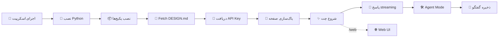

<div align="center">

<a href="https://github.com/AyhanMansur/AyhanX-Agent">
  
</a>
<br/>
<br/>
  
[](https://github.com/AyhanMansur/AyhanX-Agent/blob/main/LICENSE)
[](https://github.com/AyhanMansur/AyhanX-Agent)
[](https://linux.org)
[](https://www.python.org)
[](https://microsoft.com/powershell)
[](https://github.com/AyhanMansur/AyhanX-Agent/)
[](https://github.com/AyhanMansur/AyhanX-Agent/)

</div>

---

## 🌟 درباره پروژه

**AyhanX-Agent** یک کلاینت ترمینالی و وب پریمیوم و تک‌فایلی برای چت تعاملی با **۲۴ ارائه‌دهنده‌ی LLM** است — از DeepSeek، OpenRouter، Groq، Google AI Studio، Mistral، NVIDIA NIM و xAI گرفته تا مدل‌های کاملاً لوکال (Ollama، LM Studio، vLLM، llama.cpp، LocalAI).

طراحی آن از **Claude Code** و **Apple's Fluid Interfaces** الهام گرفته و ترکیبی از رابط گرادیانت مدرن، پاسخ‌های streaming زنده، Agent Mode با **۱۰ ابزار قدرتمند** (نوشتن فایل، اجرای شل، اجرای پایتون و …)، و نصب کاملاً خودکار را در یک اسکریپت ارائه می‌دهد.

هدف: **یک دستور اجرا کن، مستقیم وارد چت شو.**

> 🔒 **بدون منو، بدون پیکربندی دستی.** یک دستور بزن، وارد چت شو — ترمینال یا مرورگر.

| | قابلیت‌های AyhanX-Agent |
|---|---|
| 🎨 | **رابط ترمینالی پریمیوم** — لوگوی گرادیانت، chip مدل و حالت، bottom toolbar زنده |
| 🌐 | **Web UI کامل** — رابط مرورگری با design Apple-style، در `http://localhost:8080` |
| 🌊 | **پاسخ‌های streaming** — رندر زنده Markdown در هر دو رابط |
| 🛠️ | **Agent Mode قدرتمند** — ۱۰ ابزار داخلی با دسترسی کامل به فایل‌سیستم و ترمینال |
| 💾 | **مدیریت گفتگو** — ذخیره/بارگذاری خودکار + `last.json` برای resume |
| 🔄 | **مدل‌های سفارشی** — با `/model add NAME` هر مدلی رو اضافه کن |
| 🔌 | **۲۴ ارائه‌دهنده** — ابری + لوکال + Gateway |
| 🪟 | **Cross-platform** — Bash (Linux) + PowerShell (Windows) |
| ✨ | **Apple Design** — springs, velocity handoff, reduced-motion, translucent materials |
| 🎯 | **Auto-port** — اگه 8080 اشغال بود، خودکار 8081, 8082… رو امتحان می‌کنه |
| 📐 | **DESIGN.md خودکار** — principles از ریپو fetch و به agent تزریق می‌شه |
| 🔐 | **کلید امن** — ورودی مخفی، `chmod 600`، پشتیبانی از چند provider همزمان |
| 🖥️ | **Clear بعد از نصب** — فقط لوگو + چت، تمیز و پریمیوم |

---

## ⚡ شروع سریع

### 🐧 Linux

```bash
bash <(curl -Ls https://raw.githubusercontent.com/AyhanMansur/AyhanX-Agent/main/ai.sh)
```

### 🪟 Windows (PowerShell 5.1+)

```powershell
Set-ExecutionPolicy -Scope CurrentUser -ExecutionPolicy RemoteSigned
irm https://raw.githubusercontent.com/AyhanMansur/AyhanX-Agent/main/ai.ps1 | iex
```



<details>
<summary><b>📋 اسکریپت چه چیزهایی می‌پرسد</b></summary>

<br/>

1. **کلید API**: از provider انتخابی بگیر. به‌صورت مخفی وارد می‌شه و در `~/.ai_platform/.env` با `chmod 600` ذخیره می‌شه.
2. **هیچ چیز دیگه‌ای نمی‌پرسد.** مدل پیش‌فرض بر اساس provider انتخاب می‌شه.
3. **ارائه‌دهنده‌های لوکال** (Ollama، LM Studio و …) **کلید API نمی‌خوان**.
4. **DESIGN.md** خودکار از ریپو fetch می‌شه و به agent تزریق می‌شه (اگه موجود باشه).

</details>

---

## 🎮 دستورات

```bash
./ai.sh                    # چت ترمینال
./ai.sh web                # Web UI → http://localhost:8080
./ai.sh web 9000           # Web UI روی پورت دلخواه
./ai.sh ask "prompt"       # یک سؤال، یک جواب
./ai.sh health             # تست اتصال API
./ai.sh switch <provider>  # سوییچ سریع و خروج
./ai.sh config             # نمایش فایل‌های پیکربندی
./ai.sh version            # نمایش نسخه
./ai.sh --provider NAME    # force provider
```

### 🪟 Windows

```powershell
.\ai.ps1                    # چت
.\ai.ps1 -Provider ollama   # force provider
.\ai.ps1 ask "prompt"       # یک سؤال
.\ai.ps1 health             # تست اتصال
```

### داخل چت

تمام قابلیت‌ها از طریق دستورات اسلش با autocomplete کامل:

| دستور | کار |
|:-:|---|
| `/help` | لیست همه‌ی دستورات |
| `/new` | شروع گفتگوی جدید |
| `/clear` | پاک کردن صفحه |
| `/model` | نمایش لیست مدل‌ها |
| `/model NAME` | سوییچ به مدل |
| `/model refresh` | fetch زنده از سرور (لوکال) |
| `/model add NAME` | افزودن مدل سفارشی |
| `/provider` | لیست provider ها |
| `/provider NAME` | سوییچ provider |
| `/provider add NAME` | افزودن provider (prompt برای URL/key/model) |
| `/provider remove NAME` | حذف provider |
| `/system` | نمایش system prompt |
| `/system TEXT` | تنظیم system prompt |
| `/agent` | toggle Agent Mode |
| `/save [NAME]` | ذخیره گفتگو |
| `/load NAME` | بارگذاری گفتگو |
| `/chats` | لیست گفتگوها |
| `/history` | نمایش گفتگوی فعلی |
| `/info` | خلاصه پیکربندی |
| `/exit` | خروج |

<details>
<summary><b>⌨️ کلیدهای میانبر</b></summary>

<br/>

| کلید | عملکرد |
|---|---|
| `Enter` | ارسال پیام |
| `Esc + Enter` | خط جدید |
| `Ctrl + J` | خط جدید |
| `↑` / `↓` | تاریخچه ورودی |
| `Tab` | تکمیل خودکار دستور |
| `Ctrl + C` | لغو پاسخ فعلی |
| `Ctrl + D` | خروج |

</details>

---

## 🌐 Web UI

`./ai.sh web` یک رابط مرورگری کامل باز می‌کنه:

- 🎨 **Apple-style design** — spring animations, translucent materials, reduced-motion fallbacks
- 📱 **Collapsible sidebar** — دکمه `◀` با localStorage persistence
- 🌊 **Streaming** با markdown زنده
- 🛠️ **Agent mode** با نمایش tool cards
- 🔄 **Switch provider** بدون restart از modal
- 📋 **Model picker** با لیست مدل‌های provider فعلی
- 🎯 **Auto-port** — اگه 8080 busy بود، خودکار 8081+
- 🌙 **Prefers-* support** — reduced-motion, reduced-transparency, contrast

```bash
./ai.sh web         # → http://localhost:8080
./ai.sh web 9000    # → http://localhost:9000
```

---

## 🛠️ ابزارهای Agent Mode (۱۰ ابزار)

**Agent Mode** به مدل اجازه می‌ده فراتر از پاسخ متنی رفته و **عملیات واقعی** انجام دهد:

| ابزار | کار | محدودیت |
|---|---|---|
| `get_current_time` | ساعت UTC | — |
| `calculate` | محاسبه امن | eval با `__builtins__` خالی |
| `list_directory` | لیست فایل‌ها | زیر `$HOME` |
| `read_file` | خوندن فایل | 200 KB |
| `write_file` | ساخت/overwrite فایل | زیر `$HOME` |
| `edit_file` | ویرایش بخشی از فایل | unique string |
| `make_dir` | ساخت پوشه | recursive |
| `delete_file` | حذف فایل | فقط فایل، نه پوشه |
| `run_shell` | اجرای دستور شل | timeout 30s، دستورات مخرب بلاک |
| `run_python` | اجرای پایتون inline | timeout 60s |

<details>
<summary><b>💡 مثال: ساخت و اجرای اسکریپت</b></summary>

<br/>

```
❯ یه اسکریپت پایتون بنویس که اعداد فیبوناچی رو حساب کنه و اجراش کن

⏺ ⚙ write_file({"path":"fib.py","content":"..."})
   └ {"ok":true,"message":"wrote 234 bytes to /home/user/fib.py"}
  ⚙ run_shell({"command":"python3 fib.py"})
   └ 0 1 1 2 3 5 8 13 21 34...

اسکریپت رو نوشتم و اجرا کردم. خروجی: 0 1 1 2 3 5 8 13 21 34
```

</details>

---

## 🔌 ارائه‌دهنده‌های پشتیبانی‌شده (۲۴ عدد)

AyhanX-Agent بر پایه‌ی **OpenAI-compatible API** ساخته شده، پس با هر سرویسی که از این فرمت پشتیبانی کنه کار می‌کنه.

### ☁️ ابری

| ارائه‌دهنده | Endpoint | کلید |
|---|---|---|
| **DeepSeek** | `https://api.deepseek.com` | `sk-…` |
| **OpenRouter** | `https://openrouter.ai/api/v1` | `sk-or-…` |
| **Groq** | `https://api.groq.com/openai/v1` | `gsk_…` |
| **Google AI Studio** | `https://generativelanguage.googleapis.com/v1beta/openai` | `AIza…` / `AQ.…` |
| **Mistral** | `https://api.mistral.ai/v1` | (هر) |
| **Together AI** | `https://api.together.ai/v1` | (هر) |
| **Fireworks AI** | `https://api.fireworks.ai/inference/v1` | `fw_…` |
| **DeepInfra** | `https://api.deepinfra.com/v1/openai` | (هر) |
| **Perplexity** | `https://api.perplexity.ai/v1` | `pplx-…` |
| **xAI (Grok)** | `https://api.x.ai/v1` | `xai-…` |
| **Cerebras** | `https://api.cerebras.ai/v1` | `csk-…` |
| **Abacus AI** | `https://routellm.abacus.ai/v1` | (هر) |
| **Novita AI** | `https://api.novita.ai/openai/v1` | (هر) |
| **SiliconCloud** | `https://api.siliconflow.cn/v1` | (هر) |
| **ByteDance Ark** | `https://ark.cn-beijing.volces.com/api/v3` | (هر) |
| **Aliyun DashScope** | `https://dashscope.aliyuncs.com/compatible-mode/v1` | (هر) |
| **MiniMax** | `https://api.minimax.io/v1` | (هر) |
| **EdenAI** | `https://api.edenai.run/v3` | (هر) |
| **NVIDIA NIM** | `https://integrate.api.nvidia.com/v1` | `nvapi-…` |

### 🏠 لوکال (بدون کلید)

| ارائه‌دهنده | Endpoint |
|---|---|
| **Ollama** | `http://localhost:11434/v1` |
| **LM Studio** | `http://localhost:1234/v1` |
| **vLLM** | `http://localhost:8000/v1` |
| **llama.cpp** | `http://localhost:8080/v1` |
| **LocalAI** | `http://localhost:8080/v1` |
| **Ollama Cloud** | `https://ollama.com/v1` |

### 🎯 تشخیص خودکار

```bash
./ai.sh --provider auto    # پروب پورت‌های لوکال
```

یا از پیشوند کلید (`sk-or-` → OpenRouter، `nvapi-` → NVIDIA، `xai-` → Grok، …).

<details>
<summary><b>🔧 نحوه سوییچ سریع بین provider ها</b></summary>

<br/>

**از داخل چت:**

```
❯ /provider
  providers   deepseek ◆  openrouter  groq  google  mistral  nvidia  …

❯ /provider nvidia
  → switched to NVIDIA NIM
  · model    meta/llama-3.1-8b-instruct
  · endpoint https://integrate.api.nvidia.com/v1

❯ hello
```

**از CLI:**

```bash
./ai.sh switch mistral
./ai.sh switch nvidia
./ai.sh switch xai
./ai.sh switch together
```

**از post-chat menu:** `p` بزن و انتخاب کن.

**اضافه کردن provider جدید:**

```
❯ /provider add my-custom
  url: https://api.example.com/v1
  key: xxxxx
  model: model-name
  ✔ my-custom added
```

</details>

---

## 🍎 Apple Design Principles

این پروژه از **Apple's Fluid Interfaces** (WWDC 2018) الهام گرفته و اصول آن را در وب پیاده‌سازی می‌کند. جزئیات کامل در [DESIGN.md](./DESIGN.md) در ریشه ریپو موجود است.

**اصول کلیدی اعمال‌شده:**

| اصل | پیاده‌سازی |
|---|---|
| **Response** | Feedback on `:active`, not `click` |
| **Interruptibility** | Spring-based animations از مقدار فعلی شروع می‌شن |
| **Velocity Handoff** | Drag-to-close با spring که finger velocity رو حفظ می‌کنه |
| **Momentum Projection** | `project(v, 0.998)` برای flick در sidebar |
| **Rubber-banding** | Resist progressively در edges، نه hard-stop |
| **Translucent Materials** | `backdrop-filter: blur(24px) saturate(180%)` روی header/composer |
| **Spatial Consistency** | Modals از center scale می‌شن، نه از trigger |
| **Reduced Motion** | `@media (prefers-reduced-motion: reduce)` → cross-fade only |
| **Reduced Transparency** | `@media (prefers-reduced-transparency: reduce)` → solid backgrounds |
| **Typography** | `font-optical-sizing: auto`, negative tracking on display |

**DESIGN.md خودکار:** اسکریپت `DESIGN.md` رو از ریپو fetch می‌کنه و توی `~/.ai_platform/DESIGN.md` cache می‌کنه. AI Agent هم principles رو در system prompt خودش داره — وقتی می‌خوای UI بسازی، خودش اصول رو اعمال می‌کنه.

---

## 🔧 پیش‌نیازها

### 🐧 Linux
- Ubuntu، Debian یا هر توزیع با `apt`، `dnf`، `yum`، `apk` یا `pacman`
- `bash` (4.0+)، `curl`
- **Python 3.10–3.13** (خودکار از طریق `uv` نصب می‌شه)

### 🪟 Windows
- Windows 10+ با PowerShell 5.1+
- **Python 3.10–3.13** (اسکریپت خودکار نصب می‌کنه)

### 🔑 کلید API
- از هر provider انتخابی — **یا هیچ کلیدی برای لوکال‌ها**

---

## 🔐 امنیت

امنیت در سه لایه: **کلید**، **فایل‌سیستم**، و **اجرای دستورات**.

- 💾 **ذخیره امن کلید**: `~/.ai_platform/providers.json` با `chmod 600`، ورودی مخفی
- 🛡️ **فایل‌سیستم ایزوله**: همه‌ی مسیرها به `$HOME` (Linux) یا `%USERPROFILE%` (Windows) محدودن (path traversal بلاک)
- 🧮 **محاسبه امن**: `calculate` از `eval` با `__builtins__` خالی
- 🚫 **شل بلاک‌شده**: دستورات مخرب مثل `rm -rf /`، `mkfs`، `dd if=/dev/zero` رد می‌شن
- ⏱️ **timeout**: شل ۳۰ ثانیه، پایتون ۶۰ ثانیه
- 🏠 **لوکال = خصوصی**: مدل‌های لوکال به اینترنت وصل نمی‌شن
- ⚠️ **`.env` و `providers.json`** رو هرگز commit نکن

---

## ⚠️ محدودیت‌ها

- ✅ **Linux** تست شده — ✅ **Windows 10/11** (PowerShell 5.1+)
- ⚠️ **macOS** پشتیبانی رسمی نداره (ولی اسکریپت Bash باید کار کنه)
- **DeepSeek API** رایگان نیست — برای `HTTP 402` باید شارژ کنی
- **OpenRouter**، **Groq**، **NVIDIA NIM** مدل رایگان دارن — بدون شارژ کار می‌کنن
- **Tool calling** روی همه‌ی مدل‌های لوکال کار نمی‌کنه — مدل باید پشتیبانی کنه (`qwen2.5`، `llama3.3`، `deepseek-r1`)
- بعضی provider ها (Perplexity) tool calling کامل ندارن
- مدل‌های بزرگ (70B) روی NVIDIA NIM cold-start طولانی دارن

---

## 📁 ساختار فایل‌ها

همه‌چیز داخل `~/.ai_platform/` (روی Windows: `%USERPROFILE%\.ai_platform\`):

```
~/.ai_platform/
├── .env              # کلید API پیش‌فرض (chmod 600)
├── config.json       # مدل، system prompt، حالت agent
├── providers.json    # همه‌ی provider ها با کلیدها (chmod 600)
├── provider          # provider فعال
├── DESIGN.md         # Apple design principles (auto-fetched)
├── history.txt       # تاریخچه ↑↓
├── install.log       # لاگ نصب
├── runner/
│   ├── __init__.py
│   ├── tools.py      # پیاده‌سازی ۱۰ ابزار
│   ├── tui.py        # رابط ترمینالی (prompt_toolkit + Rich)
│   └── server.py     # وب UI (FastAPI + HTML)
├── chats/
│   ├── last.json     # آخرین گفتگو (resume)
│   └── *.json        # گفتگوهای ذخیره‌شده
└── .venv/            # محیط مجازی Python
```

---

## 🩺 بررسی اتصال

```bash
./ai.sh health
```

خروجی موفق (ابر):

```
  ▍Connection check
  provider  nvidia
  endpoint  https://integrate.api.nvidia.com/v1
  model     meta/llama-3.1-8b-instruct
  status    200
  reply     'OK'
  ✔ connected
```

خروجی موفق (لوکال):

```
  ▍Connection check
  provider  ollama
  endpoint  http://localhost:11434/v1
  model     qwen2.5:3b
  models    qwen2.5:3b, llama3.2:3b, deepseek-r1:7b
  status    200
  reply     'OK'
  ✔ connected
```

| کد | معنی | راه‌حل |
|:-:|---|---|
| `200` | ✅ همه چیز اوکیه | آماده‌ی چت |
| `401` | کلید نامعتبر | از سایت provider کلید جدید بگیر |
| `402` | حساب شارژ نداره | top_up کن |
| `404` | مدل پیدا نشد | `/model` یا `/model refresh` |
| `429` | Rate limit | چند لحظه صبر کن |
| `ConnectionError` | سرور لوکال بالا نیست | Ollama/LM Studio رو استارت کن |
| DNS error | اینترنت/DNS خراب | `echo "nameserver 1.1.1.1" > /etc/resolv.conf` |

---

## 🔗 لینک‌های مفید

| منبع | آدرس |
|---|---|
| **مخزن این پروژه** | [AyhanMansur/AyhanX-Agent](https://github.com/AyhanMansur/AyhanX-Agent) |
| **DESIGN.md** | [DESIGN.md](./DESIGN.md) |
| **DeepSeek** | [platform.deepseek.com](https://platform.deepseek.com) |
| **OpenRouter** | [openrouter.ai](https://openrouter.ai) |
| **Groq** | [console.groq.com](https://console.groq.com) |
| **Google AI Studio** | [aistudio.google.com/apikey](https://aistudio.google.com/apikey) |
| **Mistral** | [console.mistral.ai](https://console.mistral.ai) |
| **Together AI** | [api.together.ai](https://api.together.ai) |
| **Fireworks AI** | [fireworks.ai](https://fireworks.ai) |
| **DeepInfra** | [deepinfra.com](https://deepinfra.com) |
| **Perplexity** | [perplexity.ai/settings/api](https://www.perplexity.ai/settings/api) |
| **xAI (Grok)** | [console.x.ai](https://console.x.ai) |
| **Cerebras** | [cloud.cerebras.ai](https://cloud.cerebras.ai) |
| **Abacus AI** | [abacus.ai](https://abacus.ai) |
| **Novita AI** | [novita.ai](https://novita.ai) |
| **SiliconCloud** | [siliconflow.cn](https://siliconflow.cn) |
| **ByteDance Ark** | [console.volcengine.com/ark](https://console.volcengine.com/ark) |
| **Aliyun DashScope** | [dashscope.aliyun.com](https://dashscope.aliyun.com) |
| **MiniMax** | [platform.minimax.io](https://platform.minimax.io) |
| **EdenAI** | [edenai.co](https://www.edenai.co) |
| **NVIDIA NIM** | [build.nvidia.com](https://build.nvidia.com) |
| **Ollama** | [ollama.com](https://ollama.com) |
| **LM Studio** | [lmstudio.ai](https://lmstudio.ai) |
| **vLLM** | [docs.vllm.ai](https://docs.vllm.ai) |
| **llama.cpp** | [github.com/ggml-org/llama.cpp](https://github.com/ggml-org/llama.cpp) |
| **LocalAI** | [localai.io](https://localai.io) |

---

## 🤝 مشارکت!

این پروژه متن‌بازه و هر نوع کمک — از گزارش باگ تا افزودن provider جدید — ارزشمنده.

- 🐛 یک **Issue** باز کن
- 🔀 یک **Pull Request** بفرست
- ⭐ یک **Star** بده تا دیگران هم پیدا کنن

<details>
<summary><b>🛣️ نقشه‌ی راه</b></summary>

<br/>

**انجام‌شده ✅**

- [x] چت ترمینالی با streaming
- [x] Agent Mode با ۱۰ ابزار (فایل + شل + پایتون)
- [x] ذخیره/بارگذاری گفتگو
- [x] مدل‌های سفارشی
- [x] Resume گفتگوی قبلی
- [x] Bottom toolbar زنده
- [x] OpenRouter support
- [x] Groq support
- [x] Google AI Studio support
- [x] Mistral, Together, Fireworks, DeepInfra support
- [x] Perplexity, xAI, Cerebras, Abacus support
- [x] Novita, SiliconCloud, ByteDance, Aliyun support
- [x] MiniMax, EdenAI, **NVIDIA NIM** support
- [x] Ollama, LM Studio, vLLM, llama.cpp, LocalAI support
- [x] Ollama Cloud support
- [x] Auto-detect local server (`--provider auto`)
- [x] Windows PowerShell client (`ai.ps1`)
- [x] **Web UI** با طراحی Apple-style
- [x] **Auto-port** در Web UI
- [x] **Collapsible sidebar** با localStorage
- [x] **Apple Design principles** (springs، velocity، reduced-motion)
- [x] **DESIGN.md** خودکار از ریپو
- [x] **Switch provider** از CLI، TUI، و Web UI
- [x] **Multi-provider** در `providers.json`

**در حال کار 🚧**

- [ ] تم‌های رنگی متعدد (light/dark/auto)
- [ ] Export به Markdown
- [ ] macOS native support
- [ ] حالت `--json` برای اسکریپت‌نویسی
- [ ] پلاگین برای tool های سفارشی کاربر
- [ ] RAG (پیوست فایل)

</details>

---

## 📜 مجوز

این پروژه تحت مجوز **MIT** منتشر شده است: آزاد برای استفاده، تغییر و توزیع.

---

<div align="center">

<p>
  <b>ساخته‌شده با ❤️ توسط Ayhan Mansur</b>
</p>
