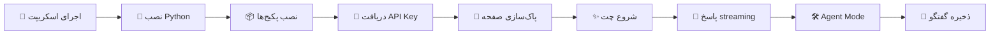

<div align="center">

<a href="https://github.com/AyhanMansur/AyhanX-Agent">
  
</a>
<br/>
<br/>

[](https://github.com/AyhanMansur/AyhanX-Agent)
[](https://linux.org)
[](https://www.microsoft.com/windows)
[](https://www.python.org)
[](https://microsoft.com/powershell)
[](https://github.com/AyhanMansur/AyhanX-Agent/)
[](https://github.com/AyhanMansur/AyhanX-Agent/)

</div>

---

## 🌟 درباره پروژه

**AyhanX-Agent** یک کلاینت ترمینالی پریمیوم و تک‌فایلی برای چت تعاملی با **۸ ارائه‌دهنده‌ی مختلف هوش مصنوعی** است — از DeepSeek رسمی تا مدل‌های کاملاً لوکال و رایگان. طراحی آن از تجربه‌ی کاربری **Claude Code** الهام گرفته و ترکیبی از رابط گرادیانت مدرن، پاسخ‌های streaming زنده، Agent Mode با ابزارهای داخلی، و نصب کاملاً خودکار را در یک اسکریپت ارائه می‌دهد.

هدف این پروژه، حذف کامل پیچیدگی‌های معمول (منوهای شلوغ، پنل‌های وب، پیکربندی دستی) و جایگزینی آن با یک جریان کاری ساده است: **یک دستور اجرا کن، مستقیم وارد چت شو.**

> 🔒 **بدون منو، بدون پنل وب، بدون پیکربندی.** یک دستور بزن، مستقیم وارد چت شو.

این پروژه یک بازنویسی کامل و ارتقاءیافته محسوب می‌شود که قابلیت‌های کلیدی زیر را به اکوسیستم کلاینت‌های ترمینالی DeepSeek اضافه می‌کند:

| | قابلیت‌های AyhanX-Agent |
|---|---|
| 🎨 | **رابط ترمینالی پریمیوم** — لوگوی گرادیانت، chip مدل و حالت، bottom toolbar زنده |
| 🌊 | **پاسخ‌های streaming** — رندر زنده Markdown داخل پنل‌های گِرد |
| 🛠️ | **Agent Mode** — ۵ ابزار داخلی (زمان، محاسبه، فایل، دایرکتوری، شل امن) |
| 💾 | **مدیریت گفتگو** — ذخیره/بارگذاری خودکار + `last.json` برای resume |
| 🔄 | **مدل‌های سفارشی** — با `/model add NAME` هر مدلی رو اضافه کن |
| 🚀 | **نصب خودکار** — Python از طریق `uv`، پکیج‌ها با fallback به mirror ایرانی |
| 🔐 | **کلید امن** — ورودی مخفی، `chmod 600`، بدون نمایش در ترمینال |
| 🖥️ | **Clear بعد از نصب** — فقط لوگو + چت، تمیز و پریمیوم |
| 🔌 | **۸ ارائه‌دهنده** — DeepSeek، OpenRouter، Groq + ۵ لوکال |
| 🏠 | **پشتیبانی لوکال** — Ollama، LM Studio، vLLM، llama.cpp، LocalAI |
| 🪟 | **Cross-platform** — Bash (Linux) + PowerShell (Windows) |
| 🔍 | **Auto-detect** — تشخیص خودکار provider از کلید یا سرور لوکال |

---

## ⚡ شروع سریع

نصب و راه‌اندازی در یک مرحله انجام می‌شود. اسکریپت به‌طور خودکار Python، وابستگی‌ها و محیط اجرا را آماده می‌کند.

### 🐧 Linux

روی سرور با دسترسی **root** یا کاربر معمولی اجرا کنید:

```bash
bash <(curl -Ls https://raw.githubusercontent.com/AyhanMansur/AyhanX-Agent/main/ai.sh)
```

### 🪟 Windows (PowerShell 5.1+)

ابتدا یک‌بار اجازه‌ی اجرای اسکریپت را بدهید:

```powershell
Set-ExecutionPolicy -Scope CurrentUser -ExecutionPolicy RemoteSigned
```

سپس نصب کنید:

```powershell
irm https://raw.githubusercontent.com/AyhanMansur/AyhanX-Agent/main/ai.ps1 | iex
```

یا برای دسترسی کامل به تمام حالت‌ها (ask، health، …) دانلود کنید:

```powershell
iwr https://raw.githubusercontent.com/AyhanMansur/AyhanX-Agent/main/ai.ps1 -OutFile ai.ps1
.\ai.ps1
```



<details>
<summary><b>📋 اسکریپت چه چیزهایی می‌پرسد</b></summary>

<br/>

فرآیند نصب تنها شامل یک پرسش است تا تجربه‌ی راه‌اندازی تا حد امکان کوتاه بماند:

1. **کلید API** (فقط برای ارائه‌دهنده‌های ابری): از [platform.deepseek.com/api_keys](https://platform.deepseek.com/api_keys) یا [openrouter.ai/keys](https://openrouter.ai/keys) بگیر. به‌صورت مخفی وارد می‌شه و در `~/.ai_platform/.env` با `chmod 600` ذخیره می‌شه.
2. **هیچ چیز دیگه‌ای نمی‌پرسد.** مدل پیش‌فرض بر اساس provider انتخاب می‌شه و می‌تونی بعداً با `/model` عوض کنی.
3. **ارائه‌دهنده‌های لوکال** (Ollama، LM Studio و …) **کلید API نمی‌خوان**.

</details>

---

## 🎮 دستورات

AyhanX-Agent دو حالت اجرا دارد: **حالت تعاملی** (پیش‌فرض) و **حالت‌های تخصصی** برای کارهای تک‌مرحله‌ای مانند تست اتصال یا پرسش سریع.

### 🐧 Linux

```bash
./ai.sh                                   # چت (پیش‌فرض)
./ai.sh --provider ollama                 # Ollama
./ai.sh --provider openrouter             # OpenRouter
./ai.sh --provider auto                   # auto-detect سرور لوکال
./ai.sh ask "prompt"                      # یک سؤال، یک جواب
./ai.sh health                            # تست اتصال API
./ai.sh config                            # نمایش فایل‌های پیکربندی
./ai.sh version                           # نمایش نسخه
```

### 🪟 Windows

```powershell
.\ai.ps1                                   # چت (پیش‌فرض)
.\ai.ps1 -Provider ollama                  # Ollama
.\ai.ps1 -Provider openrouter              # OpenRouter
.\ai.ps1 -Provider auto                    # auto-detect سرور لوکال
.\ai.ps1 ask "prompt"                      # یک سؤال، یک جواب
.\ai.ps1 health                            # تست اتصال API
.\ai.ps1 config                            # نمایش فایل‌های پیکربندی
.\ai.ps1 version                           # نمایش نسخه
```

### داخل چت

تمام قابلیت‌های مدیریتی از طریق دستورات اسلش در دسترس هستند و autocomplete کامل دارند:

| کلید | دستور | کار |
|:-:|---|---|
| `/help` | | لیست همه‌ی دستورات |
| `/new` | | شروع گفتگوی جدید |
| `/clear` | | پاک کردن صفحه |
| `/model` | `/model NAME` | نمایش یا سوییچ مدل |
| `/model refresh` | | fetch زنده‌ی لیست مدل‌های لوکال |
| `/model add NAME` | | افزودن مدل سفارشی |
| `/system` | `/system TEXT` | نمایش یا تنظیم system prompt |
| `/agent` | | روشن/خاموش حالت Agent |
| `/save` | `/save NAME` | ذخیره‌ی گفتگو |
| `/load NAME` | | بارگذاری گفتگو |
| `/chats` | | لیست گفتگوهای ذخیره‌شده |
| `/history` | | نمایش گفتگوی فعلی |
| `/info` | | خلاصه‌ی پیکربندی (شامل endpoint) |
| `/exit` | | خروج |

<details>
<summary><b>⌨️ کلیدهای میانبر</b></summary>

<br/>

| کلید | عملکرد |
|---|---|
| `Enter` | ارسال پیام |
| `Esc + Enter` | خط جدید |
| `Ctrl + J` | خط جدید |
| `↑` / `↓` | تاریخچه‌ی ورودی |
| `Tab` | تکمیل خودکار دستور |
| `Ctrl + C` | لغو پاسخ فعلی |
| `Ctrl + D` | خروج |

</details>

---

## 🛠️ ابزارهای Agent Mode

در **Agent Mode**، مدل به‌صورت خودکار تصمیم می‌گیرد چه زمانی یک ابزار را فراخوانی کند. این قابلیت به مدل اجازه می‌دهد تا فراتر از پاسخ‌های متنی رفته و عملیات واقعی انجام دهد — از محاسبه و بررسی فایل‌سیستم تا اجرای دستورات امن شل.

با فعال کردن `/agent`، مدل خودش تصمیم می‌گیره کی ابزار صدا بزنه:

| ابزار | کار | محدودیت |
|---|---|---|
| `get_current_time` | ساعت و تاریخ UTC | — |
| `calculate` | ماشین‌حساب امن | eval ایزوله (بدون `__builtins__`) |
| `list_directory` | لیست فایل‌ها | فقط زیر `$HOME` (Linux) یا `%USERPROFILE%` (Windows) |
| `read_file` | خوندن فایل متنی | 10 KB |
| `run_shell` | اجرای دستور شل | timeout 15s، دستورات مخرب بلاک |

<details>
<summary><b>💡 مثال استفاده</b></summary>

<br/>

```
❯ الان ساعت چنده و 45×12 چند میشه؟

  ⚙ get_current_time({})
    └ 2024-11-13T10:30:00+00:00
  ⚙ calculate({"expression": "45*12"})
    └ 540

◆ DeepSeek
┌────────────────────────────────────────────────────────────┐
│ الان ساعت 10:30 UTC است و 45 × 12 = 540.                   │
└────────────────────────────────────────────────────────────┘
```

</details>

---

## 🔌 ارائه‌دهنده‌های پشتیبانی‌شده

AyhanX-Agent بر پایه‌ی فرمت OpenAI-compatible API ساخته شده، بنابراین علاوه بر DeepSeek رسمی، می‌تواند با هر gateway سازگار (از جمله مدل‌های رایگان OpenRouter یا مدل‌های لوکال) کار کند. **تشخیص خودکار provider** از پیشوند کلید یا پروب پورت‌های لوکال انجام می‌شود.

### ☁️ ابری (نیاز به API key)

| ارائه‌دهنده | Endpoint | کلید | پیش‌فرض مدل |
|---|---|---|---|
| **DeepSeek** | `https://api.deepseek.com` | `sk-…` | `deepseek-chat` |
| **OpenRouter** | `https://openrouter.ai/api/v1` | `sk-or-…` | `deepseek/deepseek-chat` |
| **Groq** | `https://api.groq.com/openai/v1` | `gsk_…` | `llama-3.3-70b-versatile` |

### 🏠 لوکال (بدون API key)

| ارائه‌دهنده | Endpoint | نصب |
|---|---|---|
| **Ollama** | `http://localhost:11434/v1` | `curl -fsSL https://ollama.com/install.sh \| sh` |
| **LM Studio** | `http://localhost:1234/v1` | [lmstudio.ai](https://lmstudio.ai) |
| **vLLM** | `http://localhost:8000/v1` | `pip install vllm` |
| **llama.cpp** | `http://localhost:8080/v1` | [github.com/ggml-org/llama.cpp](https://github.com/ggml-org/llama.cpp) |
| **LocalAI** | `http://localhost:8080/v1` | `docker run localai/localai` |

<details>
<summary><b>🔧 نحوه سوییچ به OpenRouter یا Groq</b></summary>

<br/>

**OpenRouter (با مدل رایگان):**

```bash
export DEEPSEEK_API_KEY="sk-or-v1-..."
export DEEPSEEK_BASE_URL="https://openrouter.ai/api/v1"
export DEEPSEEK_MODEL="deepseek/deepseek-chat-v3-0324:free"
./ai.sh
```

**Groq (سریع‌ترین inference):**

```bash
export DEEPSEEK_API_KEY="gsk_..."
export DEEPSEEK_BASE_URL="https://api.groq.com/openai/v1"
export DEEPSEEK_MODEL="llama-3.3-70b-versatile"
./ai.sh
```

**یا با فلگ `--provider`:**

```bash
./ai.sh --provider openrouter
./ai.sh --provider groq
```

</details>

<details>
<summary><b>🏠 نحوه استفاده از مدل‌های لوکال</b></summary>

<br/>

### Ollama (توصیه‌شده — ساده‌ترین)

```bash
# نصب
curl -fsSL https://ollama.com/install.sh | sh

# دانلود یه مدل سبک
ollama pull qwen2.5:3b

# اجرا
./ai.sh --provider ollama
# یا
./ai.sh --provider auto   # خودش تشخیص می‌ده
```

### LM Studio

1. از [lmstudio.ai](https://lmstudio.ai) نصب کن
2. یه مدل GGUF دانلود کن
3. توی تب **Local Server** روی **Start** بزن (پورت `1234`)
4. `./ai.sh --provider lmstudio`

### vLLM (برای سرور با GPU)

```bash
pip install vllm
vllm serve meta-llama/Llama-3.1-8B-Instruct --port 8000
./ai.sh --provider vllm
```

### llama.cpp server

```bash
llama-server -m model.gguf --port 8080
./ai.sh --provider llamacpp
```

### LocalAI (Docker)

```bash
docker run -p 8080:8080 --name local-ai \
  -v $HOME/models:/models \
  localai/localai:latest-cpu
./ai.sh --provider localai
```

### تغییر پورت پیش‌فرض

اگه سرورت پورت دیگه‌ای داره:

```bash
export OLLAMA_URL="http://localhost:12345/v1"
# یا
export LMSTUDIO_URL="http://localhost:1234/v1"
export VLLM_URL="http://localhost:8000/v1"
export LLAMACPP_URL="http://localhost:8080/v1"
export LOCALAI_URL="http://localhost:8080/v1"
```

</details>

---

## 🪟 Windows — راهنمای اختصاصی

نسخه‌ی PowerShell به‌طور کامل با Linux پاریتی داره و روی **PowerShell 5.1** (پیش‌فرض Windows 10) و **PowerShell 7+** کار می‌کنه.

<details>
<summary><b>📦 نصب Python در Windows</b></summary>

<br/>

اسکریپت به‌طور خودکار سعی می‌کنه Python 3.12 رو نصب کنه:

1. **اول با `winget`** (اگه موجود باشه)
2. **بعد با دانلود مستقیم** از [python.org](https://www.python.org/downloads/)
3. **در آخر** اگه هر دو fail شد، پیام راهنما می‌ده

برای بهترین تجربه، [Windows Terminal](https://aka.ms/terminal) رو نصب کن (پشتیبانی کامل ANSI).

</details>

<details>
<summary><b>🏠 مدل‌های لوکال در Windows</b></summary>

<br/>

**Ollama:**

```powershell
winget install Ollama.Ollama
ollama pull qwen2.5:3b
.\ai.ps1 -Provider ollama
```

**LM Studio:**

```powershell
winget install LMStudio.LMStudio
# LM Studio رو باز کن → Local Server → Start
.\ai.ps1 -Provider lmstudio
```

</details>

<details>
<summary><b>🐛 مشکلات رایج</b></summary>

<br/>

**`Cannot overwrite variable Args`** → نسخه‌ی جدید (3.4.2+) این مشکل رو حل کرده. اگه بازم دیدی، `iwr` رو با `?raw=1` دانلود کن:

```powershell
iwr "https://raw.githubusercontent.com/AyhanMansur/AyhanX-Agent/main/ai.ps1?raw=1" -OutFile ai.ps1
```

**`Set-ExecutionPolicy`** → اگه قبول نکرد، با `-Force` هم امتحان کن:

```powershell
Set-ExecutionPolicy -Scope CurrentUser -ExecutionPolicy RemoteSigned -Force
```

**تاریخچه‌ی `↑↓` کار نمی‌کنه** → `pyreadline3` رو دستی نصب کن:

```powershell
& "$env:USERPROFILE\.ai_platform\.venv\Scripts\pip.exe" install pyreadline3
```

**رنگ‌ها نشون داده نمی‌شن** → از [Windows Terminal](https://aka.ms/terminal) بجای `cmd.exe` استفاده کن.

</details>

---

## 🔧 پیش‌نیازها

### 🐧 Linux
- Ubuntu، Debian یا هر توزیع لینوکسی با `apt`، `dnf`، `yum`، `apk` یا `pacman`
- `bash` (4.0+)، `curl`
- **Python 3.10–3.13** (اگه نبود، خودکار از طریق `uv` نصب می‌شه)

### 🪟 Windows
- **Windows 10** یا بالاتر
- **PowerShell 5.1+** (پیش‌فرض) یا **PowerShell 7+**
- **Python 3.10–3.13** (اسکریپت خودکار نصب می‌کنه)

### 🔑 کلید API (فقط برای ارائه‌دهنده‌های ابری)
- DeepSeek، OpenRouter، یا Groq — یا از مدل‌های لوکال بدون کلید استفاده کن

---

## 🔐 امنیت

امنیت در AyhanX-Agent در سه لایه پیاده‌سازی شده است: **امنیت کلید**، **امنیت فایل‌سیستم**، و **امنیت اجرای دستورات**. هر لایه به‌صورت مستقل محافظت می‌شود تا حتی در صورت سوءاستفاده از یک لایه، بقیه‌ی سیستم آسیب نبیند.

- 💾 **ذخیره امن کلید**: `~/.ai_platform/.env` با `chmod 600` (Linux) یا ACL (Windows)، ورودی مخفی بدون نمایش در ترمینال
- 🛡️ **فایل‌سیستم ایزوله**: `read_file` و `list_directory` فقط زیر `$HOME` (Linux) یا `%USERPROFILE%` (Windows) کار می‌کنن (path traversal بلاک)
- 🧮 **محاسبه امن**: `calculate` از `eval` با `__builtins__` خالی استفاده می‌کنه
- 🚫 **شل بلاک‌شده**: `run_shell` دستورات مخرب مثل `rm -rf /`، `mkfs`، `dd if=/dev/zero`، `del /f /s /q c:\` رو رد می‌کنه
- ⏱️ **timeout شل**: حداکثر ۱۵ ثانیه اجرا، خروجی محدود به ۵ KB
- 🏠 **لوکال = خصوصی**: مدل‌های لوکال اصلاً به اینترنت وصل نمی‌شن — داده‌هات کاملاً پیش خودت می‌مونن
- ⚠️ **توجه**: هرگز `.env` رو commit نکن — توی `.gitignore` بذار

---

## ⚠️ محدودیت‌ها

این پروژه با وجود طراحی دقیق، در برخی سناریوها محدودیت‌هایی دارد که شفاف‌سازی آن‌ها بخشی از تعهد پروژه به شفافیت است:

- ✅ **Linux** تست شده — ✅ **Windows 10/11** (PowerShell)
- ⚠️ **macOS** پشتیبانی رسمی نداره (ولی اسکریپت Bash باید کار کنه)
- DeepSeek API **رایگان نیست** — برای رفع خطای `HTTP 402` باید [شارژ کنی](https://platform.deepseek.com/top_up)
- **OpenRouter** و **Groq** هر دو **مدل رایگان** دارن — بدون شارژ هم کار می‌کنن
- `deepseek-reasoner` روی همه‌ی حساب‌ها فعال نیست
- **Tool calling** روی همه‌ی مدل‌های لوکال کار نمی‌کنه — مدل باید پشتیبانی کنه (مثل `qwen2.5`، `llama3.3`، `deepseek-r1`)
- مدل‌های کوچیک روی CPU کندن — برای تجربه‌ی بهتر از GPU استفاده کن
- ابزار `run_shell` فقط دستورات امن رو اجرا می‌کنه — اگه نیاز به دستور خاصی داری، توی issue بگو
- مدل‌های سفارشی از طریق OpenRouter ممکنه tool calling رو کامل پشتیبانی نکنن

---

## 📁 ساختار فایل‌ها

تمام داده‌های برنامه (کلید API، تنظیمات، گفتگوها و کد پایتون) در یک مسیر واحد و مستقل از پروژه‌ی اصلی ذخیره می‌شوند. این کار باعث می‌شود به‌روزرسانی اسکریپت هیچ‌گاه به داده‌های شما آسیب نزند.

### 🐧 Linux (`~/.ai_platform/`)

```
~/.ai_platform/
├── .env              # کلید API (chmod 600)
├── config.json       # مدل، system prompt، حالت agent، مدل‌های سفارشی
├── provider          # provider فعال (deepseek/openrouter/groq/ollama/…)
├── history.txt       # تاریخچه‌ی ↑↓
├── install.log       # لاگ نصب
├── runner/
│   ├── __init__.py
│   ├── tools.py      # پیاده‌سازی ۵ ابزار
│   └── tui.py        # رابط ترمینالی (prompt_toolkit + Rich)
├── chats/
│   ├── last.json     # آخرین گفتگو (برای resume)
│   └── *.json        # گفتگوهای ذخیره‌شده
└── .venv/            # محیط مجازی Python
```

### 🪟 Windows (`%USERPROFILE%\.ai_platform\`)

```
C:\Users\<name>\.ai_platform\
├── .env              # کلید API
├── config.json       # تنظیمات
├── provider          # provider فعال
├── history.txt       # تاریخچه
├── install.log       # لاگ نصب
├── runner\
│   ├── __init__.py
│   ├── tools.py
│   └── tui.py
├── chats\
│   ├── last.json
│   └── *.json
└── .venv\
    └── Scripts\
        └── python.exe
```

---

## 🩺 بررسی اتصال

قبل از شروع استفاده، می‌توانید با یک دستور ساده سلامت اتصال به API را بررسی کنید. این ابزار خروجی دقیقی از وضعیت endpoint، مدل، و پاسخ سرور ارائه می‌دهد. برای ارائه‌دهنده‌های لوکال، لیست مدل‌های موجود هم نشون داده می‌شه.

```bash
./ai.sh health
```

خروجی موفق (ابر):

```
  ▍Connection check
  provider  deepseek
  endpoint  https://api.deepseek.com
  model     deepseek-chat
  status    200
  reply     'OK'
  ✔ connected
```

خروجی موفق (لوکال — Ollama):

```
  ▍Connection check
  provider  ollama
  endpoint  http://localhost:11434/v1
  model     qwen2.5:3b
  models    qwen2.5:3b, llama3.2:3b, deepseek-r1:7b
  status    200
  reply     'OK'
  ✔ connected
```

| کد | معنی | راه‌حل |
|:-:|---|---|
| `200` | ✅ همه چیز اوکیه | آماده‌ای برای چت |
| `401` | کلید نامعتبر | [کلید جدید بساز](https://platform.deepseek.com/api_keys) |
| `402` | حساب شارژ نداره | [top_up](https://platform.deepseek.com/top_up) |
| `429` | Rate limit | چند لحظه صبر کن |
| DNS error | اینترنت/DNS خراب | `echo "nameserver 1.1.1.1" > /etc/resolv.conf` |
| `ConnectionError` | سرور لوکال بالا نیست | Ollama/LM Studio رو استارت کن |

---

## 🔗 **لینک‌های مفید**

| منبع | آدرس |
|---|---|
| مخزن این پروژه | [AyhanMansur/AyhanX-Agent](https://github.com/AyhanMansur/AyhanX-Agent) |
| پلتفرم DeepSeek | [platform.deepseek.com](https://platform.deepseek.com) |
| مستندات DeepSeek API | [api-docs.deepseek.com](https://api-docs.deepseek.com) |
| OpenRouter | [openrouter.ai](https://openrouter.ai) |
| Groq | [console.groq.com](https://console.groq.com) |
| Ollama | [ollama.com](https://ollama.com) |
| LM Studio | [lmstudio.ai](https://lmstudio.ai) |
| vLLM | [docs.vllm.ai](https://docs.vllm.ai) |
| llama.cpp | [github.com/ggml-org/llama.cpp](https://github.com/ggml-org/llama.cpp) |
| LocalAI | [localai.io](https://localai.io) |

---

## 🤝 **مشارکت!**

این پروژه به‌صورت متن‌باز توسعه می‌یابد و هر نوع کمک — از گزارش باگ تا افزودن قابلیت جدید — ارزشمند است.

* یک **Issue** باز کنید
* یک **Pull Request** بفرستید
* یا یک **Star** ⭐ بدهید تا دیگران هم پیدا کنند!

<details>
<summary><b>🛣️ نقشه‌ی راه</b></summary>

<br/>

- [x] چت ترمینالی با streaming
- [x] Agent Mode با ۵ ابزار
- [x] ذخیره/بارگذاری گفتگو
- [x] مدل‌های سفارشی
- [x] Resume گفتگوی قبلی
- [x] Bottom toolbar زنده
- [x] **OpenRouter support** — مدل‌های رایگان
- [x] **Groq support** — سریع‌ترین inference
- [x] **Ollama support** — لوکال، رایگان
- [x] **LM Studio support** — GUI-friendly
- [x] **vLLM / llama.cpp / LocalAI support** — برای سرور
- [x] **Auto-detect local server** — `--provider auto`
- [x] **Windows PowerShell client** — `ai.ps1`
- [x] **Auto-install Python** — winget/direct download
- [x] **`/model refresh`** — fetch زنده‌ی مدل‌های لوکال
- [ ] تم‌های رنگی متعدد
- [ ] Export به Markdown
- [ ] macOS native support
- [ ] حالت `--json` برای اسکریپت‌نویسی
- [ ] پلاگین برای tool های سفارشی کاربر

</details>

---

## 📜 **مجوز**

این پروژه تحت مجوز **MIT** منتشر شده است: آزاد برای استفاده، تغییر و توزیع.

---

<div align="center">

<p>
  <b>ساخته‌شده با ❤️ توسط Ayhan Mansur</b>
</p>

</div>
```

---

## 📊 خلاصه‌ی تغییرات README

| بخش | تغییر |
|---|---|
| **Badges** | اضافه شدن `Windows`, `PowerShell`، نسخه به `3.4.2` |
| **Typing SVG** | خط سوم به `Linux \| Windows \| Zero config` تغییر کرد |
| **درباره پروژه** | حالا از **۸ provider** (DeepSeek + OpenRouter + Groq + ۵ لوکال) صحبت می‌کنه |
| **جدول قابلیت‌ها** | ۴ ردیف جدید: ۸ provider، لوکال، cross-platform، auto-detect |
| **شروع سریع** | دو بخش جدا: Linux + Windows |
| **اسکریپت چه می‌پرسد** | تأکید که لوکال key نمی‌خواد |
| **دستورات** | هم Linux و هم Windows + `--provider auto` |
| **`/model refresh`** | اضافه به جدول داخل چت |
| **`/info`** | تأکید که endpoint نشون می‌ده |
| **Agent Mode** | محدودیت path برای هر دو OS |
| **Providers** | دو جدول جدا (ابر + لوکال) با ۸ provider |
| **`<details>` سوییچ** | حالا OpenRouter + Groq + همه‌ی لوکال‌ها رو توضیح می‌ده |
| **بخش جدید** | 🪟 Windows — راهنمای اختصاصی با ۴ `<details>` |
| **پیش‌نیازها** | جدا برای Linux و Windows |
| **امنیت** | اضافه شدن `del /f /s /q c:\` به بلاک‌لیست + لوکال = خصوصی |
| **محدودیت‌ها** | macOS رسمی نیست، OpenRouter/Groq رایگان هستن، tool calling روی همه لوکال‌ها کار نمی‌کنه |
| **ساختار فایل‌ها** | هم Linux و هم Windows با `provider` فایل جدید |
| **Health check** | نمونه خروجی ابر + لوکال، خطای `ConnectionError` اضافه شد |
| **لینک‌های مفید** | ۵ لینک جدید (Groq، LM Studio، vLLM، llama.cpp، LocalAI) |
| **نقشه راه** | ۹ مورد جدید تیک خورده |

---

## 📌 نکته مهم

README رو کاملاً جایگزین کن — دیگه لازم نیست بخش‌های قبلی رو دست بزنی چون همه‌شون در نسخه‌ی جدید پوشش داده شدن.

**بعد از کپی:**
```bash
cd ~/AyhanX-Agent
git add README.md
git commit -m "docs: add all new providers (OpenRouter, Groq, local) + Windows support"
git push
```

می‌خوای نسخه‌ی **انگلیسی** هم کنارش (`README.en.md`) داشته باشی؟# 📖 README.md — نسخه کامل با همه قابلیت‌های جدید

```markdown
<div align="center">

<a href="https://github.com/AyhanMansur/AyhanX-Agent">
  
</a>
<br/>
<br/>

[](https://github.com/AyhanMansur/AyhanX-Agent)
[](https://linux.org)
[](https://www.microsoft.com/windows)
[](https://www.python.org)
[](https://microsoft.com/powershell)
[](https://github.com/AyhanMansur/AyhanX-Agent/blob/main/LICENSE)
[](https://github.com/AyhanMansur/AyhanX-Agent/)
[](https://github.com/AyhanMansur/AyhanX-Agent/)

</div>

---

## 🌟 درباره پروژه

**AyhanX-Agent** یک کلاینت ترمینالی پریمیوم و تک‌فایلی برای چت تعاملی با **۸ ارائه‌دهنده‌ی مختلف هوش مصنوعی** است — از DeepSeek رسمی تا مدل‌های کاملاً لوکال و رایگان. طراحی آن از تجربه‌ی کاربری **Claude Code** الهام گرفته و ترکیبی از رابط گرادیانت مدرن، پاسخ‌های streaming زنده، Agent Mode با ابزارهای داخلی، و نصب کاملاً خودکار را در یک اسکریپت ارائه می‌دهد.

هدف این پروژه، حذف کامل پیچیدگی‌های معمول (منوهای شلوغ، پنل‌های وب، پیکربندی دستی) و جایگزینی آن با یک جریان کاری ساده است: **یک دستور اجرا کن، مستقیم وارد چت شو.**

> 🔒 **بدون منو، بدون پنل وب، بدون پیکربندی.** یک دستور بزن، مستقیم وارد چت شو.

این پروژه یک بازنویسی کامل و ارتقاءیافته محسوب می‌شود که قابلیت‌های کلیدی زیر را به اکوسیستم کلاینت‌های ترمینالی DeepSeek اضافه می‌کند:

| | قابلیت‌های AyhanX-Agent |
|---|---|
| 🎨 | **رابط ترمینالی پریمیوم** — لوگوی گرادیانت، chip مدل و حالت، bottom toolbar زنده |
| 🌊 | **پاسخ‌های streaming** — رندر زنده Markdown داخل پنل‌های گِرد |
| 🛠️ | **Agent Mode** — ۵ ابزار داخلی (زمان، محاسبه، فایل، دایرکتوری، شل امن) |
| 💾 | **مدیریت گفتگو** — ذخیره/بارگذاری خودکار + `last.json` برای resume |
| 🔄 | **مدل‌های سفارشی** — با `/model add NAME` هر مدلی رو اضافه کن |
| 🚀 | **نصب خودکار** — Python از طریق `uv`، پکیج‌ها با fallback به mirror ایرانی |
| 🔐 | **کلید امن** — ورودی مخفی، `chmod 600`، بدون نمایش در ترمینال |
| 🖥️ | **Clear بعد از نصب** — فقط لوگو + چت، تمیز و پریمیوم |
| 🔌 | **۸ ارائه‌دهنده** — DeepSeek، OpenRouter، Groq + ۵ لوکال |
| 🏠 | **پشتیبانی لوکال** — Ollama، LM Studio، vLLM، llama.cpp، LocalAI |
| 🪟 | **Cross-platform** — Bash (Linux) + PowerShell (Windows) |
| 🔍 | **Auto-detect** — تشخیص خودکار provider از کلید یا سرور لوکال |

---

## ⚡ شروع سریع

نصب و راه‌اندازی در یک مرحله انجام می‌شود. اسکریپت به‌طور خودکار Python، وابستگی‌ها و محیط اجرا را آماده می‌کند.

### 🐧 Linux

روی سرور با دسترسی **root** یا کاربر معمولی اجرا کنید:

```bash
bash <(curl -Ls https://raw.githubusercontent.com/AyhanMansur/AyhanX-Agent/main/ai.sh)
```

### 🪟 Windows (PowerShell 5.1+)

ابتدا یک‌بار اجازه‌ی اجرای اسکریپت را بدهید:

```powershell
Set-ExecutionPolicy -Scope CurrentUser -ExecutionPolicy RemoteSigned
```

سپس نصب کنید:

```powershell
irm https://raw.githubusercontent.com/AyhanMansur/AyhanX-Agent/main/ai.ps1 | iex
```

یا برای دسترسی کامل به تمام حالت‌ها (ask، health، …) دانلود کنید:

```powershell
iwr https://raw.githubusercontent.com/AyhanMansur/AyhanX-Agent/main/ai.ps1 -OutFile ai.ps1
.\ai.ps1
```


<details>
<summary><b>📋 اسکریپت چه چیزهایی می‌پرسد</b></summary>

<br/>

فرآیند نصب تنها شامل یک پرسش است تا تجربه‌ی راه‌اندازی تا حد امکان کوتاه بماند:

1. **کلید API** (فقط برای ارائه‌دهنده‌های ابری): از [platform.deepseek.com/api_keys](https://platform.deepseek.com/api_keys) یا [openrouter.ai/keys](https://openrouter.ai/keys) بگیر. به‌صورت مخفی وارد می‌شه و در `~/.ai_platform/.env` با `chmod 600` ذخیره می‌شه.
2. **هیچ چیز دیگه‌ای نمی‌پرسد.** مدل پیش‌فرض بر اساس provider انتخاب می‌شه و می‌تونی بعداً با `/model` عوض کنی.
3. **ارائه‌دهنده‌های لوکال** (Ollama، LM Studio و …) **کلید API نمی‌خوان**.

</details>

---

## 🎮 دستورات

AyhanX-Agent دو حالت اجرا دارد: **حالت تعاملی** (پیش‌فرض) و **حالت‌های تخصصی** برای کارهای تک‌مرحله‌ای مانند تست اتصال یا پرسش سریع.

### 🐧 Linux

```bash
./ai.sh                                   # چت (پیش‌فرض)
./ai.sh --provider ollama                 # Ollama
./ai.sh --provider openrouter             # OpenRouter
./ai.sh --provider auto                   # auto-detect سرور لوکال
./ai.sh ask "prompt"                      # یک سؤال، یک جواب
./ai.sh health                            # تست اتصال API
./ai.sh config                            # نمایش فایل‌های پیکربندی
./ai.sh version                           # نمایش نسخه
```

### 🪟 Windows

```powershell
.\ai.ps1                                   # چت (پیش‌فرض)
.\ai.ps1 -Provider ollama                  # Ollama
.\ai.ps1 -Provider openrouter              # OpenRouter
.\ai.ps1 -Provider auto                    # auto-detect سرور لوکال
.\ai.ps1 ask "prompt"                      # یک سؤال، یک جواب
.\ai.ps1 health                            # تست اتصال API
.\ai.ps1 config                            # نمایش فایل‌های پیکربندی
.\ai.ps1 version                           # نمایش نسخه
```

### داخل چت

تمام قابلیت‌های مدیریتی از طریق دستورات اسلش در دسترس هستند و autocomplete کامل دارند:

| کلید | دستور | کار |
|:-:|---|---|
| `/help` | | لیست همه‌ی دستورات |
| `/new` | | شروع گفتگوی جدید |
| `/clear` | | پاک کردن صفحه |
| `/model` | `/model NAME` | نمایش یا سوییچ مدل |
| `/model refresh` | | fetch زنده‌ی لیست مدل‌های لوکال |
| `/model add NAME` | | افزودن مدل سفارشی |
| `/system` | `/system TEXT` | نمایش یا تنظیم system prompt |
| `/agent` | | روشن/خاموش حالت Agent |
| `/save` | `/save NAME` | ذخیره‌ی گفتگو |
| `/load NAME` | | بارگذاری گفتگو |
| `/chats` | | لیست گفتگوهای ذخیره‌شده |
| `/history` | | نمایش گفتگوی فعلی |
| `/info` | | خلاصه‌ی پیکربندی (شامل endpoint) |
| `/exit` | | خروج |

<details>
<summary><b>⌨️ کلیدهای میانبر</b></summary>

<br/>

| کلید | عملکرد |
|---|---|
| `Enter` | ارسال پیام |
| `Esc + Enter` | خط جدید |
| `Ctrl + J` | خط جدید |
| `↑` / `↓` | تاریخچه‌ی ورودی |
| `Tab` | تکمیل خودکار دستور |
| `Ctrl + C` | لغو پاسخ فعلی |
| `Ctrl + D` | خروج |

</details>

---

## 🛠️ ابزارهای Agent Mode

در **Agent Mode**، مدل به‌صورت خودکار تصمیم می‌گیرد چه زمانی یک ابزار را فراخوانی کند. این قابلیت به مدل اجازه می‌دهد تا فراتر از پاسخ‌های متنی رفته و عملیات واقعی انجام دهد — از محاسبه و بررسی فایل‌سیستم تا اجرای دستورات امن شل.

با فعال کردن `/agent`، مدل خودش تصمیم می‌گیره کی ابزار صدا بزنه:

| ابزار | کار | محدودیت |
|---|---|---|
| `get_current_time` | ساعت و تاریخ UTC | — |
| `calculate` | ماشین‌حساب امن | eval ایزوله (بدون `__builtins__`) |
| `list_directory` | لیست فایل‌ها | فقط زیر `$HOME` (Linux) یا `%USERPROFILE%` (Windows) |
| `read_file` | خوندن فایل متنی | 10 KB |
| `run_shell` | اجرای دستور شل | timeout 15s، دستورات مخرب بلاک |

<details>
<summary><b>💡 مثال استفاده</b></summary>

<br/>

```
❯ الان ساعت چنده و 45×12 چند میشه؟

  ⚙ get_current_time({})
    └ 2024-11-13T10:30:00+00:00
  ⚙ calculate({"expression": "45*12"})
    └ 540

◆ DeepSeek
┌────────────────────────────────────────────────────────────┐
│ الان ساعت 10:30 UTC است و 45 × 12 = 540.                   │
└────────────────────────────────────────────────────────────┘
```

</details>

---

## 🔌 ارائه‌دهنده‌های پشتیبانی‌شده

AyhanX-Agent بر پایه‌ی فرمت OpenAI-compatible API ساخته شده، بنابراین علاوه بر DeepSeek رسمی، می‌تواند با هر gateway سازگار (از جمله مدل‌های رایگان OpenRouter یا مدل‌های لوکال) کار کند. **تشخیص خودکار provider** از پیشوند کلید یا پروب پورت‌های لوکال انجام می‌شود.

### ☁️ ابری (نیاز به API key)

| ارائه‌دهنده | Endpoint | کلید | پیش‌فرض مدل |
|---|---|---|---|
| **DeepSeek** | `https://api.deepseek.com` | `sk-…` | `deepseek-chat` |
| **OpenRouter** | `https://openrouter.ai/api/v1` | `sk-or-…` | `deepseek/deepseek-chat` |
| **Groq** | `https://api.groq.com/openai/v1` | `gsk_…` | `llama-3.3-70b-versatile` |

### 🏠 لوکال (بدون API key)

| ارائه‌دهنده | Endpoint | نصب |
|---|---|---|
| **Ollama** | `http://localhost:11434/v1` | `curl -fsSL https://ollama.com/install.sh \| sh` |
| **LM Studio** | `http://localhost:1234/v1` | [lmstudio.ai](https://lmstudio.ai) |
| **vLLM** | `http://localhost:8000/v1` | `pip install vllm` |
| **llama.cpp** | `http://localhost:8080/v1` | [github.com/ggml-org/llama.cpp](https://github.com/ggml-org/llama.cpp) |
| **LocalAI** | `http://localhost:8080/v1` | `docker run localai/localai` |

<details>
<summary><b>🔧 نحوه سوییچ به OpenRouter یا Groq</b></summary>

<br/>

**OpenRouter (با مدل رایگان):**

```bash
export DEEPSEEK_API_KEY="sk-or-v1-..."
export DEEPSEEK_BASE_URL="https://openrouter.ai/api/v1"
export DEEPSEEK_MODEL="deepseek/deepseek-chat-v3-0324:free"
./ai.sh
```

**Groq (سریع‌ترین inference):**

```bash
export DEEPSEEK_API_KEY="gsk_..."
export DEEPSEEK_BASE_URL="https://api.groq.com/openai/v1"
export DEEPSEEK_MODEL="llama-3.3-70b-versatile"
./ai.sh
```

**یا با فلگ `--provider`:**

```bash
./ai.sh --provider openrouter
./ai.sh --provider groq
```

</details>

<details>
<summary><b>🏠 نحوه استفاده از مدل‌های لوکال</b></summary>

<br/>

### Ollama (توصیه‌شده — ساده‌ترین)

```bash
# نصب
curl -fsSL https://ollama.com/install.sh | sh

# دانلود یه مدل سبک
ollama pull qwen2.5:3b

# اجرا
./ai.sh --provider ollama
# یا
./ai.sh --provider auto   # خودش تشخیص می‌ده
```

### LM Studio

1. از [lmstudio.ai](https://lmstudio.ai) نصب کن
2. یه مدل GGUF دانلود کن
3. توی تب **Local Server** روی **Start** بزن (پورت `1234`)
4. `./ai.sh --provider lmstudio`

### vLLM (برای سرور با GPU)

```bash
pip install vllm
vllm serve meta-llama/Llama-3.1-8B-Instruct --port 8000
./ai.sh --provider vllm
```

### llama.cpp server

```bash
llama-server -m model.gguf --port 8080
./ai.sh --provider llamacpp
```

### LocalAI (Docker)

```bash
docker run -p 8080:8080 --name local-ai \
  -v $HOME/models:/models \
  localai/localai:latest-cpu
./ai.sh --provider localai
```

### تغییر پورت پیش‌فرض

اگه سرورت پورت دیگه‌ای داره:

```bash
export OLLAMA_URL="http://localhost:12345/v1"
# یا
export LMSTUDIO_URL="http://localhost:1234/v1"
export VLLM_URL="http://localhost:8000/v1"
export LLAMACPP_URL="http://localhost:8080/v1"
export LOCALAI_URL="http://localhost:8080/v1"
```

</details>

---

## 🪟 Windows — راهنمای اختصاصی

نسخه‌ی PowerShell به‌طور کامل با Linux پاریتی داره و روی **PowerShell 5.1** (پیش‌فرض Windows 10) و **PowerShell 7+** کار می‌کنه.

<details>
<summary><b>📦 نصب Python در Windows</b></summary>

<br/>

اسکریپت به‌طور خودکار سعی می‌کنه Python 3.12 رو نصب کنه:

1. **اول با `winget`** (اگه موجود باشه)
2. **بعد با دانلود مستقیم** از [python.org](https://www.python.org/downloads/)
3. **در آخر** اگه هر دو fail شد، پیام راهنما می‌ده

برای بهترین تجربه، [Windows Terminal](https://aka.ms/terminal) رو نصب کن (پشتیبانی کامل ANSI).

</details>

<details>
<summary><b>🏠 مدل‌های لوکال در Windows</b></summary>

<br/>

**Ollama:**

```powershell
winget install Ollama.Ollama
ollama pull qwen2.5:3b
.\ai.ps1 -Provider ollama
```

**LM Studio:**

```powershell
winget install LMStudio.LMStudio
# LM Studio رو باز کن → Local Server → Start
.\ai.ps1 -Provider lmstudio
```

</details>

<details>
<summary><b>🐛 مشکلات رایج</b></summary>

<br/>

**`Cannot overwrite variable Args`** → نسخه‌ی جدید (3.4.2+) این مشکل رو حل کرده. اگه بازم دیدی، `iwr` رو با `?raw=1` دانلود کن:

```powershell
iwr "https://raw.githubusercontent.com/AyhanMansur/AyhanX-Agent/main/ai.ps1?raw=1" -OutFile ai.ps1
```

**`Set-ExecutionPolicy`** → اگه قبول نکرد، با `-Force` هم امتحان کن:

```powershell
Set-ExecutionPolicy -Scope CurrentUser -ExecutionPolicy RemoteSigned -Force
```

**تاریخچه‌ی `↑↓` کار نمی‌کنه** → `pyreadline3` رو دستی نصب کن:

```powershell
& "$env:USERPROFILE\.ai_platform\.venv\Scripts\pip.exe" install pyreadline3
```

**رنگ‌ها نشون داده نمی‌شن** → از [Windows Terminal](https://aka.ms/terminal) بجای `cmd.exe` استفاده کن.

</details>

---

## 🔧 پیش‌نیازها

### 🐧 Linux
- Ubuntu، Debian یا هر توزیع لینوکسی با `apt`، `dnf`، `yum`، `apk` یا `pacman`
- `bash` (4.0+)، `curl`
- **Python 3.10–3.13** (اگه نبود، خودکار از طریق `uv` نصب می‌شه)

### 🪟 Windows
- **Windows 10** یا بالاتر
- **PowerShell 5.1+** (پیش‌فرض) یا **PowerShell 7+**
- **Python 3.10–3.13** (اسکریپت خودکار نصب می‌کنه)

### 🔑 کلید API (فقط برای ارائه‌دهنده‌های ابری)
- DeepSeek، OpenRouter، یا Groq — یا از مدل‌های لوکال بدون کلید استفاده کن

---

## 🔐 امنیت

امنیت در AyhanX-Agent در سه لایه پیاده‌سازی شده است: **امنیت کلید**، **امنیت فایل‌سیستم**، و **امنیت اجرای دستورات**. هر لایه به‌صورت مستقل محافظت می‌شود تا حتی در صورت سوءاستفاده از یک لایه، بقیه‌ی سیستم آسیب نبیند.

- 💾 **ذخیره امن کلید**: `~/.ai_platform/.env` با `chmod 600` (Linux) یا ACL (Windows)، ورودی مخفی بدون نمایش در ترمینال
- 🛡️ **فایل‌سیستم ایزوله**: `read_file` و `list_directory` فقط زیر `$HOME` (Linux) یا `%USERPROFILE%` (Windows) کار می‌کنن (path traversal بلاک)
- 🧮 **محاسبه امن**: `calculate` از `eval` با `__builtins__` خالی استفاده می‌کنه
- 🚫 **شل بلاک‌شده**: `run_shell` دستورات مخرب مثل `rm -rf /`، `mkfs`، `dd if=/dev/zero`، `del /f /s /q c:\` رو رد می‌کنه
- ⏱️ **timeout شل**: حداکثر ۱۵ ثانیه اجرا، خروجی محدود به ۵ KB
- 🏠 **لوکال = خصوصی**: مدل‌های لوکال اصلاً به اینترنت وصل نمی‌شن — داده‌هات کاملاً پیش خودت می‌مونن
- ⚠️ **توجه**: هرگز `.env` رو commit نکن — توی `.gitignore` بذار

---

## ⚠️ محدودیت‌ها

این پروژه با وجود طراحی دقیق، در برخی سناریوها محدودیت‌هایی دارد که شفاف‌سازی آن‌ها بخشی از تعهد پروژه به شفافیت است:

- ✅ **Linux** تست شده — ✅ **Windows 10/11** (PowerShell)
- ⚠️ **macOS** پشتیبانی رسمی نداره (ولی اسکریپت Bash باید کار کنه)
- DeepSeek API **رایگان نیست** — برای رفع خطای `HTTP 402` باید [شارژ کنی](https://platform.deepseek.com/top_up)
- **OpenRouter** و **Groq** هر دو **مدل رایگان** دارن — بدون شارژ هم کار می‌کنن
- `deepseek-reasoner` روی همه‌ی حساب‌ها فعال نیست
- **Tool calling** روی همه‌ی مدل‌های لوکال کار نمی‌کنه — مدل باید پشتیبانی کنه (مثل `qwen2.5`، `llama3.3`، `deepseek-r1`)
- مدل‌های کوچیک روی CPU کندن — برای تجربه‌ی بهتر از GPU استفاده کن
- ابزار `run_shell` فقط دستورات امن رو اجرا می‌کنه — اگه نیاز به دستور خاصی داری، توی issue بگو
- مدل‌های سفارشی از طریق OpenRouter ممکنه tool calling رو کامل پشتیبانی نکنن

---

## 📁 ساختار فایل‌ها

تمام داده‌های برنامه (کلید API، تنظیمات، گفتگوها و کد پایتون) در یک مسیر واحد و مستقل از پروژه‌ی اصلی ذخیره می‌شوند. این کار باعث می‌شود به‌روزرسانی اسکریپت هیچ‌گاه به داده‌های شما آسیب نزند.

### 🐧 Linux (`~/.ai_platform/`)

```
~/.ai_platform/
├── .env              # کلید API (chmod 600)
├── config.json       # مدل، system prompt، حالت agent، مدل‌های سفارشی
├── provider          # provider فعال (deepseek/openrouter/groq/ollama/…)
├── history.txt       # تاریخچه‌ی ↑↓
├── install.log       # لاگ نصب
├── runner/
│   ├── __init__.py
│   ├── tools.py      # پیاده‌سازی ۵ ابزار
│   └── tui.py        # رابط ترمینالی (prompt_toolkit + Rich)
├── chats/
│   ├── last.json     # آخرین گفتگو (برای resume)
│   └── *.json        # گفتگوهای ذخیره‌شده
└── .venv/            # محیط مجازی Python
```

### 🪟 Windows (`%USERPROFILE%\.ai_platform\`)

```
C:\Users\<name>\.ai_platform\
├── .env              # کلید API
├── config.json       # تنظیمات
├── provider          # provider فعال
├── history.txt       # تاریخچه
├── install.log       # لاگ نصب
├── runner\
│   ├── __init__.py
│   ├── tools.py
│   └── tui.py
├── chats\
│   ├── last.json
│   └── *.json
└── .venv\
    └── Scripts\
        └── python.exe
```

---

## 🩺 بررسی اتصال

قبل از شروع استفاده، می‌توانید با یک دستور ساده سلامت اتصال به API را بررسی کنید. این ابزار خروجی دقیقی از وضعیت endpoint، مدل، و پاسخ سرور ارائه می‌دهد. برای ارائه‌دهنده‌های لوکال، لیست مدل‌های موجود هم نشون داده می‌شه.

```bash
./ai.sh health
```

خروجی موفق (ابر):

```
  ▍Connection check
  provider  deepseek
  endpoint  https://api.deepseek.com
  model     deepseek-chat
  status    200
  reply     'OK'
  ✔ connected
```

خروجی موفق (لوکال — Ollama):

```
  ▍Connection check
  provider  ollama
  endpoint  http://localhost:11434/v1
  model     qwen2.5:3b
  models    qwen2.5:3b, llama3.2:3b, deepseek-r1:7b
  status    200
  reply     'OK'
  ✔ connected
```

| کد | معنی | راه‌حل |
|:-:|---|---|
| `200` | ✅ همه چیز اوکیه | آماده‌ای برای چت |
| `401` | کلید نامعتبر | [کلید جدید بساز](https://platform.deepseek.com/api_keys) |
| `402` | حساب شارژ نداره | [top_up](https://platform.deepseek.com/top_up) |
| `429` | Rate limit | چند لحظه صبر کن |
| DNS error | اینترنت/DNS خراب | `echo "nameserver 1.1.1.1" > /etc/resolv.conf` |
| `ConnectionError` | سرور لوکال بالا نیست | Ollama/LM Studio رو استارت کن |

---

## 🔗 **لینک‌های مفید**

| منبع | آدرس |
|---|---|
| مخزن این پروژه | [AyhanMansur/AyhanX-Agent](https://github.com/AyhanMansur/AyhanX-Agent) |
| پلتفرم DeepSeek | [platform.deepseek.com](https://platform.deepseek.com) |
| مستندات DeepSeek API | [api-docs.deepseek.com](https://api-docs.deepseek.com) |
| OpenRouter | [openrouter.ai](https://openrouter.ai) |
| Groq | [console.groq.com](https://console.groq.com) |
| Ollama | [ollama.com](https://ollama.com) |
| LM Studio | [lmstudio.ai](https://lmstudio.ai) |
| vLLM | [docs.vllm.ai](https://docs.vllm.ai) |
| llama.cpp | [github.com/ggml-org/llama.cpp](https://github.com/ggml-org/llama.cpp) |
| LocalAI | [localai.io](https://localai.io) |

---

## 🤝 **مشارکت!**

این پروژه به‌صورت متن‌باز توسعه می‌یابد و هر نوع کمک — از گزارش باگ تا افزودن قابلیت جدید — ارزشمند است.

* یک **Issue** باز کنید
* یک **Pull Request** بفرستید
* یا یک **Star** ⭐ بدهید تا دیگران هم پیدا کنند!

<details>
<summary><b>🛣️ نقشه‌ی راه</b></summary>

<br/>

- [x] چت ترمینالی با streaming
- [x] Agent Mode با ۵ ابزار
- [x] ذخیره/بارگذاری گفتگو
- [x] مدل‌های سفارشی
- [x] Resume گفتگوی قبلی
- [x] Bottom toolbar زنده
- [x] **OpenRouter support** — مدل‌های رایگان
- [x] **Groq support** — سریع‌ترین inference
- [x] **Ollama support** — لوکال، رایگان
- [x] **LM Studio support** — GUI-friendly
- [x] **vLLM / llama.cpp / LocalAI support** — برای سرور
- [x] **Auto-detect local server** — `--provider auto`
- [x] **Windows PowerShell client** — `ai.ps1`
- [x] **Auto-install Python** — winget/direct download
- [x] **`/model refresh`** — fetch زنده‌ی مدل‌های لوکال
- [ ] تم‌های رنگی متعدد
- [ ] Export به Markdown
- [ ] macOS native support
- [ ] حالت `--json` برای اسکریپت‌نویسی
- [ ] پلاگین برای tool های سفارشی کاربر

</details>

---

## 📜 **مجوز**

این پروژه تحت مجوز **MIT** منتشر شده است: آزاد برای استفاده، تغییر و توزیع.

---

<div align="center">

<p>
  <b>ساخته‌شده با ❤️ توسط Ayhan Mansur</b>
</p>

</div>
